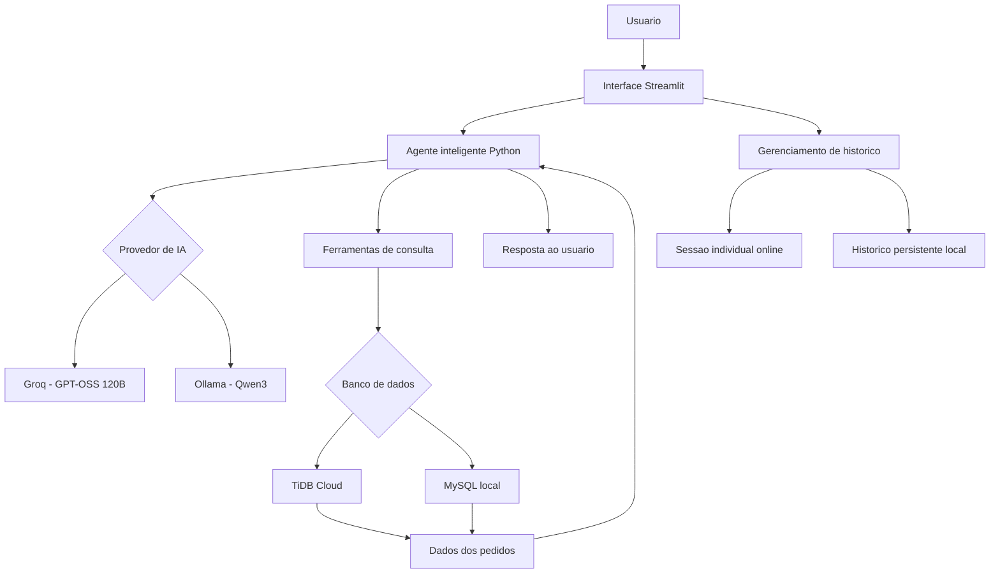
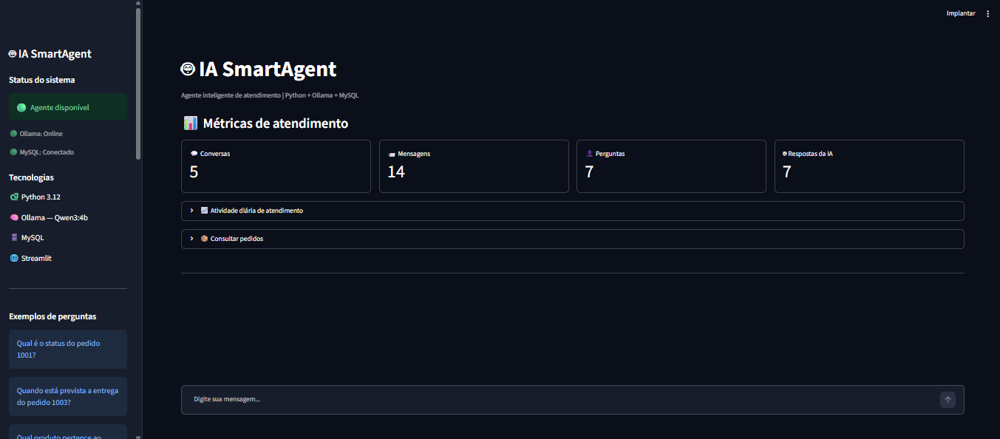

# 🤖 SmartAgent AI


## 🌐 Acesse o aplicativo

[](https://smartagent-ai.streamlit.app)

**Link:** https://smartagent-ai.streamlit.app

Não é necessário instalar nenhum programa para experimentar a versão online.

## 📌 Sobre o projeto

O SmartAgent AI é um agente inteligente de atendimento ao cliente, desenvolvido para automatizar consultas de pedidos utilizando inteligência artificial generativa, integração com bancos de dados e análise de indicadores operacionais.

O sistema interpreta perguntas em linguagem natural, executa ferramentas de consulta ao banco de dados e apresenta respostas baseadas nos registros disponíveis.

A aplicação possui dois ambientes de execução: local e em nuvem.

## 🎯 Objetivos

- Automatizar consultas de atendimento.
- Facilitar o acesso às informações operacionais.
- Reduzir tarefas repetitivas.
- Integrar inteligência artificial com bancos de dados.
- Monitorar indicadores de atendimento.
- Demonstrar aplicações práticas de IA em processos empresariais.

## 🚀 Funcionalidades

- Chat inteligente com IA generativa.
- Consultas de pedidos em linguagem natural.
- Consulta de produtos, clientes e status.
- Consulta de previsões de entrega.
- Análise inteligente de dados.
- Ranking de produtos por quantidade de pedidos.
- Contagem de clientes e pedidos.
- Análise de pedidos cancelados, atrasados e entregues.
- Dashboard de métricas de atendimento.
- Gráfico de atividade diária.
- Tabela interativa de pedidos.
- Pesquisa e filtros de registros.
- Criação e renomeação de conversas.
- Exclusão e exportação de conversas em TXT.
- Histórico individual por sessão na versão online.
- Histórico persistente na versão local.
- Monitoramento das conexões.
- Interface com tema escuro.

## 🛠️ Tecnologias utilizadas

| Tecnologia | Finalidade |
|---|---|
| Python | Desenvolvimento da aplicação |
| Streamlit | Interface web |
| Groq | Inferência de IA na nuvem |
| GPT-OSS 120B | Modelo de linguagem online |
| TiDB Cloud | Banco de dados na nuvem |
| Ollama | Execução local da IA |
| Qwen3:4b | Modelo de linguagem local |
| MySQL | Banco de dados local |
| Pandas | Manipulação de dados |
| Altair | Visualização de dados |
| Python-dotenv | Variáveis de ambiente |
| Git e GitHub | Versionamento |
| Streamlit Community Cloud | Hospedagem |

## 🏗️ Arquitetura do sistema



## ☁️ Ambientes de execução

| Recurso | Versão local | Versão online |
|---|---|---|
| Inteligência artificial | Ollama | Groq |
| Modelo | Qwen3:4b | GPT-OSS 120B |
| Banco de dados | MySQL | TiDB Cloud |
| Histórico | Persistente | Temporário por sessão |
| Hospedagem | Computador local | Streamlit Cloud |

## 📸 Demonstração do sistema




## 🗄️ Banco de dados

A base de demonstração contém dados fictícios.

| Indicador | Quantidade |
|---|---:|
| Pedidos | 100 |
| Clientes distintos | 100 |
| Produtos distintos | 16 |
| Tipos de status | 6 |
| Datas de entrega distintas | 31 |

### Estrutura das tabelas

| Tabela | Finalidade |
|---|---|
| pedidos | Informações dos pedidos |
| historico_conversas | Mensagens do ambiente local |
| titulos_conversas | Títulos das conversas locais |

## 📊 Indicadores de atendimento

- Total de conversas.
- Total de mensagens.
- Total de perguntas.
- Total de respostas da IA.
- Atividade diária de atendimento.

## 💬 Exemplos de perguntas

- Qual é o status do pedido 1001?
- Quando está prevista a entrega do pedido 1003?
- Quantos pedidos temos no total?
- Quantos clientes estão cadastrados?
- Quantos pedidos estão cancelados?
- Qual produto possui mais pedidos?
- Quantos pedidos estão em transporte?

## 📁 Estrutura do projeto

```text
SmartAgent-AI/
├── .streamlit/
│   └── config.toml
├── certificados/
│   └── tidb-ca.pem
├── images/
├── .env.example
├── .gitignore
├── agente.py
├── app.py
├── database.py
├── database.sql
├── historico.py
├── provedor_ia.py
├── requirements.txt
└── README.md
```

## ⚙️ Instalação local

### 1. Clonar o repositório

```bash
git clone https://github.com/Gustavo-010101/SmartAgent-AI.git
cd SmartAgent-AI
```

### 2. Criar o ambiente virtual

```bash
python -m venv .venv
```

No Windows:

```powershell
.\.venv\Scripts\Activate.ps1
```

### 3. Instalar as dependências

```bash
pip install -r requirements.txt
```

### 4. Configurar o MySQL

Execute o arquivo database.sql no MySQL Workbench.

Crie uma cópia do arquivo .env.example com o nome .env e configure:

```env
PROVEDOR_IA=ollama
PROVEDOR_DB=mysql
MODO_PUBLICO=false

DB_HOST=localhost
DB_USER=seu_usuario
DB_PASSWORD=sua_senha
DB_NAME=smartagent_ai
```

### 5. Configurar o Ollama

```bash
ollama pull qwen3:4b
```

Certifique-se de que o Ollama esteja em execução.

### 6. Iniciar o aplicativo

```bash
python -m streamlit run app.py
```

## ☁️ Configuração na nuvem

A versão online utiliza Groq e TiDB Cloud.

As variáveis necessárias estão documentadas no arquivo .env.example.

Na hospedagem, as credenciais devem ser configuradas na seção Secrets do Streamlit Cloud.

## 🔒 Segurança e privacidade

- Credenciais armazenadas em variáveis de ambiente.
- Arquivos privados protegidos pelo .gitignore.
- Conexão TLS com verificação do certificado.
- Usuário do banco online com permissão de leitura.
- Histórico individual por sessão na versão pública.
- Base de demonstração composta por dados fictícios.
- Ferramentas de consulta previamente definidas.

O histórico online é temporário e pode ser perdido ao encerrar ou recarregar a sessão.

A versão online está sujeita aos limites de utilização dos serviços de hospedagem, banco de dados e inteligência artificial.

## 🧠 Competências demonstradas

- Inteligência artificial generativa.
- Modelos de linguagem (LLMs).
- Desenvolvimento de agentes inteligentes.
- Tool Calling.
- Engenharia de prompts.
- Programação em Python.
- SQL e bancos de dados relacionais.
- Integração de APIs.
- Computação em nuvem.
- Análise e visualização de dados.
- Segurança e privacidade.
- Automação de processos.
- Desenvolvimento de aplicações web.
- Versionamento de código.
- Deploy de aplicações.

## 👨‍💻 Desenvolvedor

**Gustavo Alves Favoreto**

Projeto desenvolvido para portfólio profissional, com foco em tecnologia, inteligência artificial, análise de dados e automação de processos empresariais.

- GitHub: https://github.com/Gustavo-010101
- Aplicativo: https://smartagent-ai.streamlit.app

---

⭐ Se você gostou do projeto, considere deixar uma estrela no repositório.